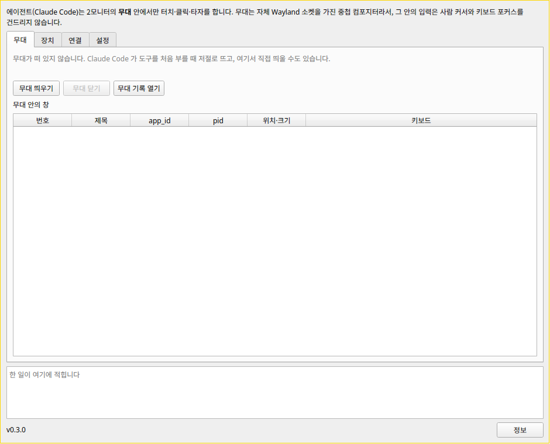

# CursorIyagi

Lets an AI agent test apps without touching your cursor or keyboard focus.

AI 에이전트가 앱을 시험하는 동안 내 커서와 키보드 포커스를 건드리지 않게 해 주는 도구.

- Runs the app under test inside a nested Wayland compositor, the "stage"
- Taps, clicks and typing go only into the stage — your own work on the other monitor is left alone
- Screenshot and window tools for Claude Code
- Linux only

- 시험할 앱을 중첩 Wayland 컴포지터인 "무대" 안에서 실행합니다
- 터치·클릭·타자는 무대 안으로만 들어가 내 작업을 방해하지 않습니다
- Claude Code가 쓰는 화면 찍기·창 도구
- 리눅스 전용

> Not released yet — downloads will appear under [Releases](../../releases) when it is ready.
> 아직 공개 전입니다. 준비되면 [Releases](../../releases)에 올라옵니다.

